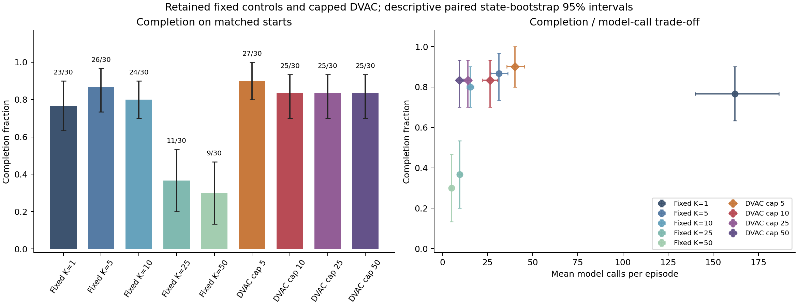
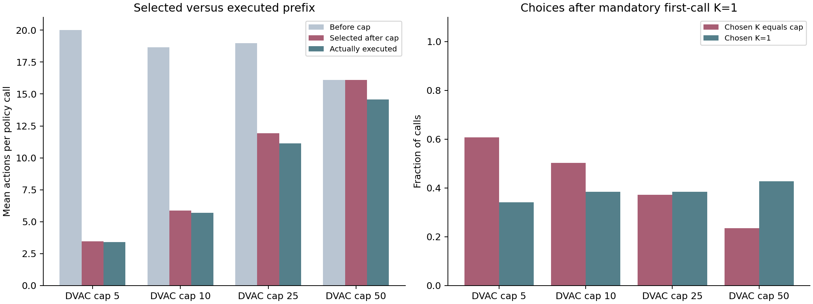

# VLA: how often should a robot replan?

A controlled study of when a robot should obtain a new observation and regenerate
its actions. A pretrained **SmolVLA** policy, running through **LeRobot**, controls a
robot in **LIBERO / MuJoCo** from two camera images, robot state, and a language
instruction. No model training is performed.

The main comparison contains **270 matched episodes and nine methods**: five fixed
execution intervals and four variants of denoising-variance adaptive chunking
(**DVAC**). It measures task completion and model calls, and uses videos and action
logs to examine corrections and failure behavior.

**[Full report](output/pdf/vla-capped-replanning-report.pdf)** ·
**[Comparison demo](outputs/capped-report/demo.mp4)** ·
**[Results and tables](outputs/capped-report/report.md)** ·
**[Protocol](docs/capped-protocol.md)** ·
**[Reproduction](docs/capped-reproduction.md)**

## How replanning works

```text
Two camera images + robot state + instruction
                        ↓
       SmolVLA generates H = 50 actions
       using 10 flow-matching iterations
                        ↓
        Execute the first K actions
                        ↓
        New observation → new prediction
```

An action controls translation, rotation, and the gripper. The generated horizon
**H=50 remains fixed**. Unexecuted actions are discarded when the robot replans.

- **Fixed intervals:** execute K = 1, 5, 10, 25, or 50 actions before replanning.
- **Capped DVAC:** select an interval from internal flow-matching variance, then
  apply `K = min(C, K_DVAC)`, with execution cap C = 5, 10, 25, or 50.

DVAC records the last five clean-action estimates `z_i = x_i - t_i v_i` within a
single model call. It measures their population variance for each future action,
summing over the seven valid normalized action coordinates. It selects the prefix
before the first variance exceeding `mean(W) + 2 * std(W)`, where W contains the
variance arrays from up to five preceding calls. The first call executes K=1 to
initialize this history; history resets every episode.

The cap limits execution only: every method still generates all 50 actions with
all ten flow-matching iterations. The robot executes the final sampled actions,
not the average intermediate estimate. The [protocol](docs/capped-protocol.md)
gives the equations, indexing, initialization, and implementation choices.

The simulator advances at 20 Hz and pauses during inference. K therefore determines
a simulated observation interval, not a wall-clock control rate. Changing K changes
both access to fresh observations and the frequency of stochastic action generation.

## Matched design

| Task | LIBERO suite | Initial states |
|---|---|---:|
| Pick up the alphabet soup can and place it in the basket | Object | 10 |
| Pick up the black bowl between the plate and ramekin and place it on the plate | Spatial | 10 |
| Open the middle drawer | Goal | 10 |

All nine methods use state indices 0–9 and policy seed 11: **30 task/state settings
per method**. The checkpoint, observation processing, simulator assets, action
normalization, precision, prediction horizon, solver, control frequency, and episode
limits are shared. Initial simulator states, observations, and complete first action
predictions match exactly across methods.

The comparison reuses 150 verified fixed-interval controls and adds 120 adaptive
episodes on the same starts. All 270 episodes passed independent trace and video
verification. Historical controls used different CPU threading and did not capture
FM diagnostics, so fixed-versus-adaptive computational comparisons use **model calls**.
Timing is reported separately among the four adaptive caps, which share measurement
conditions. No old-versus-new wall-time speedup is claimed.

## Results

Each method has ten episodes per task. Model calls are averaged over all 30 episodes;
failed episodes are included. Calls per 100 actions use the ratio of total calls to
total executed actions.

| Method | Soup | Bowl | Drawer | Completed | Mean model calls | Calls / 100 actions |
|---|---:|---:|---:|---:|---:|---:|
| Fixed K=1 | 6/10 | 8/10 | 9/10 | 23/30 | 162.0 | 100.00 |
| Fixed K=5 | 9/10 | 7/10 | 10/10 | 26/30 | 31.3 | 20.23 |
| Fixed K=10 | 10/10 | 4/10 | 10/10 | 24/30 | 15.5 | 10.22 |
| Fixed K=25 | 6/10 | 4/10 | 1/10 | 11/30 | 9.6 | 4.18 |
| Fixed K=50 | 3/10 | 3/10 | 3/10 | 9/30 | 5.1 | 2.13 |
| DVAC cap 5 | 10/10 | 7/10 | 10/10 | **27/30** | 40.2 | 29.24 |
| DVAC cap 10 | 10/10 | 7/10 | 8/10 | 25/30 | 26.4 | 17.53 |
| DVAC cap 25 | 10/10 | 8/10 | 7/10 | 25/30 | 14.1 | 8.97 |
| DVAC cap 50 | 9/10 | 7/10 | 9/10 | 25/30 | 9.5 | 6.86 |



**A smaller cap did not consistently improve completion.** Caps 10, 25, and 50 each
completed 25/30 episodes, while their mean call counts were 26.4, 14.1, and 9.5.
Cap 5 had the highest observed count, 27/30, at 40.2 calls per episode. Compared with
fixed K=5, it added one successful episode and 8.9 calls per episode; the paired
completion difference was +3.3 percentage points, with a descriptive 95% interval
of [0.0, +10.0]. This sample does not establish a universal best method.

The two designated comparisons show why both outcomes and cost matter:

- **DVAC cap 10 versus fixed K=10:** +3.3 percentage points in completion
  (95% interval [−10.0, +16.7]), with 10.9 additional calls per episode. DVAC alone
  succeeded in three settings; fixed K=10 alone succeeded in two.
- **DVAC cap 10 versus cap 50:** no aggregate completion difference
  (95% interval [−16.7, +16.7]), with 16.9 additional calls per episode. Each method
  succeeded in three settings where the other failed. Equal counts do not mean
  identical behavior or equivalent reliability.

Intervals use **10,000 paired bootstrap samples of initial states within each task**,
keeping all methods together and weighting tasks equally. They are descriptive,
not multiplicity-adjusted confirmatory tests. The [full results](outputs/capped-report/report.md)
are accompanied by [all 36 paired comparisons](outputs/capped-report/paired_contrasts.csv),
task-level tables, and every individual outcome.

## Behavior and demonstration

The [demo](outputs/capped-report/demo.mp4) shows **fixed K=10, DVAC cap 10, and DVAC
cap 50** side by side for state 0 / seed 11 on all three tasks. These examples were
selected independently of their outcomes. The instruction, current K, model-call
count, replanning moments, and outcome remain visible. Panels advance together in
simulation time; ended episodes hold their final observation.

Adaptive behavior is not described adequately by an average interval. The mean
selected K was 3.45, 5.87, 11.92, and 16.09 for caps 5, 10, 25, and 50. After
initialization, approximately 34–43% of calls still selected K=1. The actual executed
prefix can be shorter than selected K when an episode ends.



The [review materials](outputs/capped-report/review/review.json) also include the
first cap-10/cap-50 disagreement in each direction under the frozen collection order.
These are explicitly outcome-selected illustrations. The full report separates
observed behavior from hypotheses about failure causes. A gripper command, action
jump, or contact is not automatically a grasp error or a successful correction.
Qualitative annotations are assistant-generated without independent human review.

## What the comparison establishes

The experiment measures a completion/computation trade-off for this checkpoint and
these initial situations. It tests the **complete DVAC scheduling rule and its
execution cap**. It does not isolate the usefulness of denoising variance itself:
establishing that contribution would require a control schedule matched on model-call
budget or execution-interval distribution.

Only three tasks and one policy seed are represented in the main comparison. The
state outcomes were already examined while developing the experiment, so this is
an exploratory comparison, not a held-out confirmation. Internal FM stability does
not guarantee a correct action. The results do not isolate fresh observations from
stochastic regeneration, establish equivalence from an interval containing zero, or
demonstrate real-time control of a physical robot. LIBERO success follows its native
predicate and may occur before release; post-release stability is not evaluated.

## Supplementary comparisons

**Uncapped DVAC, 48 episodes.** A separate comparison uses states 15 and 16, seeds
11 and 22, and fixed K=5/10/25 versus DVAC. It includes six physical settings and
shared diagnostic instrumentation across its four methods. Its episodes are **not
pooled into the main 270-episode comparison**. See the
[adaptive report](output/pdf/vla-dvac-report.pdf),
[results](outputs/dvac-report/report.md), [demo](outputs/dvac-report/demo.mp4), and
[protocol](docs/dvac-protocol.md).

**Moving target, 135 episodes.** A soup-can experiment compares an unforced control
with two oscillating force-reference periods, using states 10–14, seeds 11/22/33,
and K=5/10/50. The external force is removed permanently at first finger contact;
ordinary contact physics continues. Contact is not itself proof of a grasp.
Its matched controls and analysis remain separate. See the
[report](output/pdf/vla-replanning-complete-report.pdf),
[demo](outputs/moving-target-report/demo.mp4),
[protocol](docs/moving-target-protocol.md), and
[visual review](outputs/moving-target-report/demo-review.json).

The original fixed-interval [report](output/pdf/vla-replanning-report.pdf),
[paired video cases](outputs/expanded/demo.mp4),
[complete fixed-outcome plot](outputs/expanded/report/state-outcomes.png), and
[annotations](outputs/expanded/report/annotations.csv), with their
[discussion](docs/report-outline.md), are also preserved.

## Evidence and reproduction

The [reproduction guide](docs/capped-reproduction.md) covers compatibility checks,
collection, tests, verification, and rebuilding the report and demo. The
[verification record](outputs/capped-report/verification.json) checks all predicted
and executed actions, FM variances, rolling thresholds, caps, sampling seeds, matching
starts, source hashes, and video alignment. The
[statistics](outputs/capped-report/analysis.json) and
[artifact hashes](outputs/capped-report/artifacts.json) bind the tables and figures to
the verified evidence. All 30 matched blocks are visible in the
[outcome matrix](outputs/capped-report/outcome_matrix.csv).

The implementation is in `vla_replan/`, `adaptive_replan/`, and `capped_replan/`;
configurations are in `configs/` and analysis tools in `scripts/`. Model weights and
virtual environments are excluded from the repository.

## Sources

- [SmolVLA paper](https://arxiv.org/abs/2506.01844).
- [DVAC: Denoising Tells When to Replan](https://arxiv.org/html/2606.03847v1).
- [Pinned SmolVLA LIBERO checkpoint](https://huggingface.co/HuggingFaceVLA/smolvla_libero/tree/6721902bc4d61e50a3bfdb11dfb4cb626f05d102).
- [SmolVLA implementation in LeRobot](https://github.com/huggingface/lerobot/blob/v0.6.1/src/lerobot/policies/smolvla/modeling_smolvla.py).
- [LIBERO documentation](https://huggingface.co/docs/lerobot/en/libero).

The project's contribution is the explicit execution-prefix control, the DVAC transfer
and cap intervention, paired comparisons, independent evidence verification, and
behavioral analysis. It is not a reproduction of the DVAC paper's complete benchmark.
The pretrained policy and simulator are third-party components with their own licenses.
