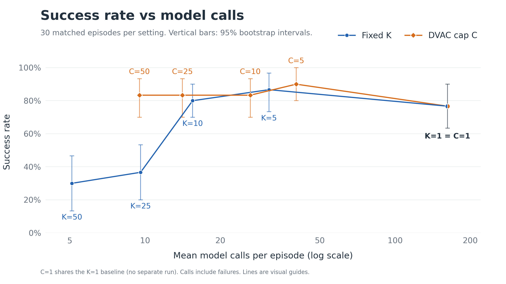
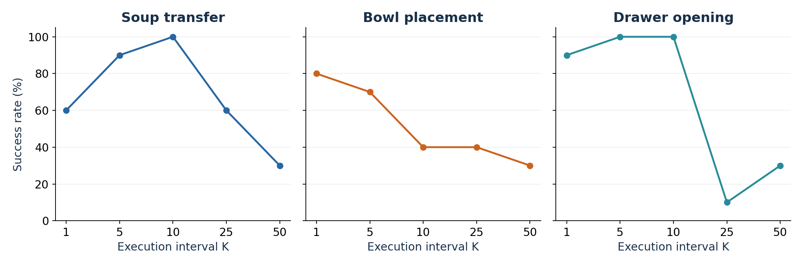
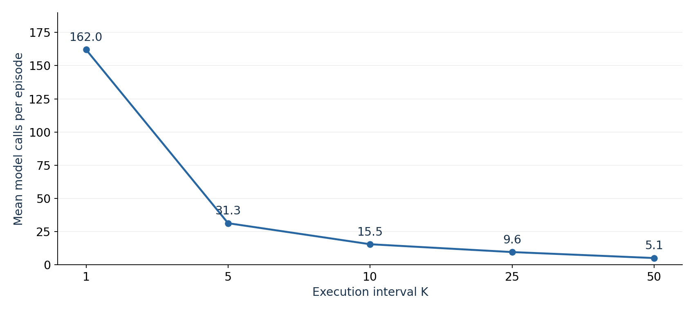
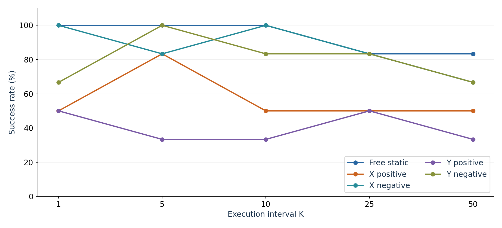
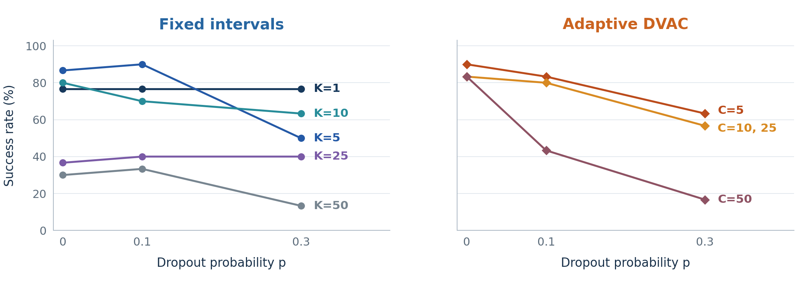
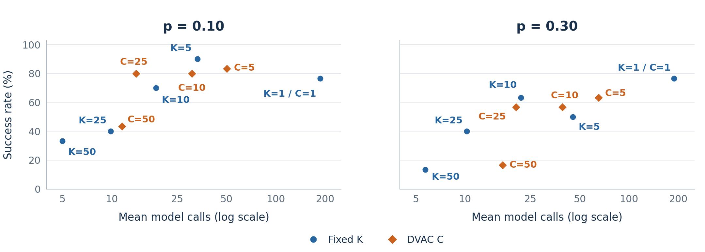

# VLA: how often should a robot replan?

**Amir Sadreev and Vasilii Liamin**

**Research question: how does replanning frequency change task success and model-call cost?**

A pretrained **SmolVLA** policy controls a robot in **LIBERO / MuJoCo** through
**LeRobot**. We compare fixed execution intervals and adaptive replanning under
normal execution, target motion, and random command dropout. No model training or
fine-tuning is performed.

## Demonstration

[Watch the side-by-side comparison (MP4)](outputs/capped-report/demo.mp4)

Fixed K=10, DVAC C=10, and DVAC C=50 run from the same initial state on each of
three tasks. The video shows the instruction, execution interval, model-call count,
replanning moments, and outcome. Panels are synchronized in simulation time;
playback does not represent inference speed.

## One observation produces 50 candidate actions

For example, the task instruction is:

> Pick up the alphabet soup and place it in the basket.

The model receives two 256 × 256 RGB images (external and wrist cameras), the
instruction, and eight robot-state values: position, orientation, and finger
positions. Its flow-matching action expert predicts **50 × 7 values**: 50 actions,
each containing three translations, three rotations, and one gripper command.
LIBERO defines the task; MuJoCo simulates the robot and environment.

## The executor sets the replanning interval

```text
Two camera images + robot state + instruction
                     ↓
        Predict a block of H = 50 actions
        using M = 10 flow-matching steps
                     ↓
          Execute the first K actions
                     ↓
     Observe again and discard the unused suffix
                     ↓
              Predict a new block
```

| Symbol | Meaning | Setting |
|---|---|---|
| H | Predicted action horizon | 50 actions |
| M | Internal flow-matching iterations per call | 10 |
| K | Actions executed before the next observation | Fixed or selected adaptively |
| C | Maximum execution interval for DVAC | 5, 10, 25, or 50 |

Prediction stays fixed; execution changes. At 20 Hz, K=1, 10, and 50 correspond to
0.05, 0.5, and 2.5 seconds of simulated execution before a new observation. The
simulator pauses during inference, so this is not a wall-clock control rate.

## DVAC selects K from internal FM disagreement

**Denoising-Variance Adaptive Chunking (DVAC)** uses the last five clean-action
estimates within a single model call:

$$z_i = x_i - t_i v_i.$$

Here, x is the noisy action block, t is flow time, and v is predicted flow velocity.
Each estimate contains 50 × 7 coordinates. For each future action j, DVAC sums the
population variance across its seven normalized coordinates:

$$V_j = \sum_{d=1}^{7} \mathrm{Var}_i(z_{i,j,d}).$$

W stores variance values from up to five previous calls. The threshold is:

$$\tau = \mathrm{mean}(W) + 2\mathrm{std}(W).$$

Let j* be the first **zero-based** action index with V_j greater than the threshold.
The execution interval is:

$$K = \min(C, \max(1,j^*)).$$

For example, j*=4 and C=10 means executing four actions. If there is no crossing,
K=min(C,50). The first call executes K=1; history is updated after choosing K and
reset for every episode. The robot executes the final sampled actions, not an
average of intermediate estimates.

This signal measures internal disagreement, not calibrated confidence. The
comparison tests the whole scheduling rule; it does not isolate the value of
variance from the schedule or model-call budget.

## Nine execution rules, the same 30 starts

**270 episodes = 3 tasks × 10 initial states × 9 rules.**

| Task | LIBERO suite | Initial states |
|---|---|---:|
| Pick up the alphabet soup can and place it in the basket | Object | 10 |
| Pick up the black bowl between the plate and ramekin and place it on the plate | Spatial | 10 |
| Open the middle drawer | Goal | 10 |

- **Fixed intervals:** K=1, 5, 10, 25, 50.
- **Adaptive DVAC caps:** C=5, 10, 25, 50.

Every rule uses the same 30 starts, state indices 0–9 and policy seed 11. Checkpoint,
precision (FP32), observation processing, H=50, M=10, and 20 Hz control are held
fixed. Initial simulator states, images, and first predicted action blocks match.
Episode limits are 280 or 300 control steps, depending on the task.

**Mean model calls include failures.** One call generates the entire action block;
the ten internal FM iterations are not counted as ten policy calls.

## Success rate versus model calls



Higher success and fewer calls are preferable. The horizontal axis is logarithmic;
lines are visual guides, not interpolated measurements. C=1 shares the K=1 baseline
and is not a separate run.

- **Fixed K=5:** 26/30 successes with 31.3 calls, versus 23/30 and 162.0 calls for K=1.
- **DVAC C=50:** 25/30 successes with 9.5 calls, about 70% fewer calls than fixed K=5.
- **DVAC C=5:** the highest observed success count, 27/30, with 40.2 calls.

Vertical bars are descriptive 95% intervals from 10,000 paired resamples of initial
states within tasks. There are no horizontal intervals. Similar success totals do
not establish equal reliability, and overlapping intervals are not a test of paired
differences.

## The best observed K depends on the task



The best observed fixed interval is K=10 for soup transfer, K=1 for bowl placement,
and K=5 or K=10 for drawer opening. Each point represents only ten episodes with one
policy seed. These are descriptive rankings, not universal optima.

## Model calls fall as K increases



K=1 requires 162.0 calls per episode on average; K=5 requires 31.3 and K=50 requires
5.1. For a fixed-K episode, calls equal ceil(executed steps / K). Episode lengths
also change with success and termination, so the mean is not simply one common
constant divided by K. Lower call counts alone do not make a method better.

## The same cap can produce opposite outcomes

The presentation's examples show why aggregate totals do not describe every episode:

- **Soup, state 3:** C=10 succeeds at step 143; C=50 moves an empty gripper and fails.
- **Bowl, state 0:** C=50 succeeds at step 81; C=10 keeps repositioning and fails.

These cases describe visible behavior. They do not establish a causal mechanism or
a universally optimal cap.

## Moving target: a paired test in four directions

**150 episodes = 3 robot states × 2 can positions × 5 K × 5 motion conditions.**

The soup can starts at offsets A=(-1.5,0) cm or B=(+1.5,+1.5) cm. Conditions are a
free static control and movement along +X, -X, +Y, or -Y, the perpendicular tabletop
axes. The commanded drive is 1.5 cm/s; actual free-motion speed is approximately
0.91 cm/s. Motion ramps up between 0.5 and 1.0 seconds and the drive ends at bilateral
finger contact. Parameters are frozen before evaluation on robot states 30–32.



Each point uses the same six scenarios, with one policy seed and three robot-state
clusters. For +X, K=5 completes 5/6 cases versus 3/6 for K=1. For -X, K=1 and K=10
both complete 6/6. **Motion direction changes the outcome; a moving target does not
make K=1 universally best.**

## Random action dropout

At each control step, the translation command is skipped with probability **p**.
Rotation and gripper commands still run; simulation time advances. The policy sees
the resulting state at its next scheduled observation, without an explicit failure
flag.

- **Probabilities:** p=0.1, 0.3; p=0 is the reference.
- **Comparison:** three tasks × ten starts, fixed K and adaptive DVAC.
- **Measures:** task success and mean model calls over all episodes.
- **Matching:** the same starts and dropout masks at corresponding control steps.

**Does higher p make shorter replanning intervals more useful?**

### Task success under dropout



In the displayed comparison, the best fixed K is 5 at p=0 and p=0.10, and 1 at
p=0.30. Performance need not decrease monotonically for every individual setting.

### Success and model calls under dropout



At p=0.30, K=1 completes 23/30 episodes with 187.8 calls, while K=10 completes 19/30
with 21.9 calls. That is **8.6 times as many calls for four additional successes**.
Both panels use the same axes; all completed episodes contribute to call means.

## Our answer: the useful interval depends on execution conditions

1. **Clean execution: K=5 balances success and calls.** It completes 26/30 episodes
   with 31.3 calls, versus 23/30 with 162.0 calls for K=1.
2. **At high tested dropout, K=1 has the highest observed task success.** At p=0.30,
   it achieves 23/30, but at a substantial model-call cost.
3. **On average, DVAC suffers more from random command dropout.** From p=0 to
   p=0.30, success drops 36.7 percentage points for DVAC versus 16.7 points for fixed
   intervals, averaged over the same limits 5, 10, 25, and 50. This does not hold for
   every individual cap.

These findings concern one model, three main tasks, one policy seed, and simulated
execution. FM variance is a heuristic. Small success differences do not establish
statistical superiority, and simulation does not establish real-robot performance.
The tested disturbances cover only some possible execution errors.

## Appendix: main results (p=0)

Task columns count successes out of ten; totals are out of 30. Calls are means over
all episodes, including failures.

| Method | Soup | Bowl | Drawer | Completed | Mean model calls |
|---|---:|---:|---:|---:|---:|
| Fixed K=1 | 6/10 | 8/10 | 9/10 | 23/30 | 162.0 |
| Fixed K=5 | 9/10 | 7/10 | 10/10 | 26/30 | 31.3 |
| Fixed K=10 | 10/10 | 4/10 | 10/10 | 24/30 | 15.5 |
| Fixed K=25 | 6/10 | 4/10 | 1/10 | 11/30 | 9.6 |
| Fixed K=50 | 3/10 | 3/10 | 3/10 | 9/30 | 5.1 |
| DVAC cap 5 | 10/10 | 7/10 | 10/10 | **27/30** | 40.2 |
| DVAC cap 10 | 10/10 | 7/10 | 8/10 | 25/30 | 26.4 |
| DVAC cap 25 | 10/10 | 8/10 | 7/10 | 25/30 | 14.1 |
| DVAC cap 50 | 9/10 | 7/10 | 9/10 | 25/30 | 9.5 |

## Appendix: dropout success counts

| Method | p=0 | p=0.10 | p=0.30 |
|---|---:|---:|---:|
| Fixed K=1 | 23/30 | 23/30 | 23/30 |
| Fixed K=5 | 26/30 | 27/30 | 15/30 |
| Fixed K=10 | 24/30 | 21/30 | 19/30 |
| Fixed K=25 | 11/30 | 12/30 | 12/30 |
| Fixed K=50 | 9/30 | 10/30 | 4/30 |
| DVAC C=5 | 27/30 | 25/30 | 19/30 |
| DVAC C=10 | 25/30 | 24/30 | 17/30 |
| DVAC C=25 | 25/30 | 24/30 | 17/30 |
| DVAC C=50 | 25/30 | 13/30 | 5/30 |

## Appendix: dropout model calls

Mean model calls across all completed episodes, including failures; read alongside
the success counts.

| Method | p=0 | p=0.10 | p=0.30 |
|---|---:|---:|---:|
| Fixed K=1 | 162.0 | 186.4 | 187.8 |
| Fixed K=5 | 31.3 | 33.3 | 45.3 |
| Fixed K=10 | 15.5 | 18.6 | 21.9 |
| Fixed K=25 | 9.6 | 9.8 | 10.2 |
| Fixed K=50 | 5.1 | 5.0 | 5.7 |
| DVAC C=5 | 40.2 | 50.2 | 65.1 |
| DVAC C=10 | 26.4 | 30.9 | 39.1 |
| DVAC C=25 | 14.1 | 14.1 | 20.4 |
| DVAC C=50 | 9.5 | 11.5 | 16.9 |

## Implementation and reproduction

- [Experimental protocol](docs/capped-protocol.md)
- [Reproduction guide](docs/capped-reproduction.md)

The implementation is in `vla_replan/`, `adaptive_replan/`, `capped_replan/`,
`moving_target/`, and `action_dropout/`. Configurations are in `configs/`; collection
and analysis scripts are in `scripts/`. Model weights and virtual environments are
excluded from the repository.

The main and dropout graph images are extracted from the final defense presentation.
Task, call-count, and moving-target plots reproduce its chart values.

## Sources

- [SmolVLA paper](https://arxiv.org/abs/2506.01844)
- [DVAC: Denoising Tells When to Replan](https://arxiv.org/html/2606.03847v1)
- [Pinned SmolVLA LIBERO checkpoint](https://huggingface.co/HuggingFaceVLA/smolvla_libero/tree/6721902bc4d61e50a3bfdb11dfb4cb626f05d102)
- [SmolVLA implementation](https://github.com/huggingface/lerobot/blob/v0.6.1/src/lerobot/policies/smolvla/modeling_smolvla.py)
- [LIBERO documentation](https://huggingface.co/docs/lerobot/en/libero)

The contribution is execution-prefix control, adaptation of the DVAC scheduling
rule, matched comparisons, and behavioral analysis. The pretrained model and
simulator are existing third-party components; this is not a reproduction of the
DVAC paper's complete benchmark.
