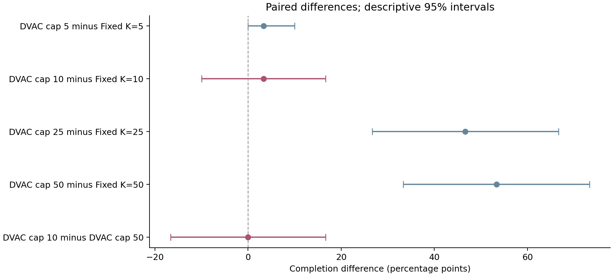
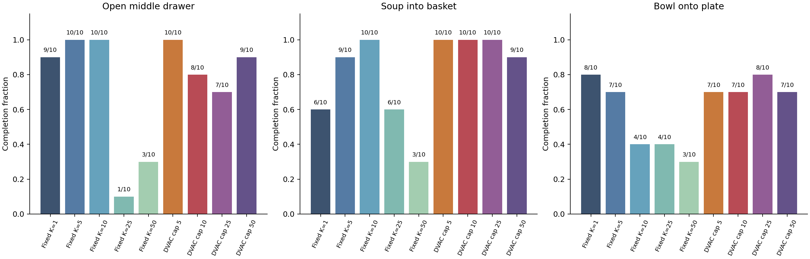
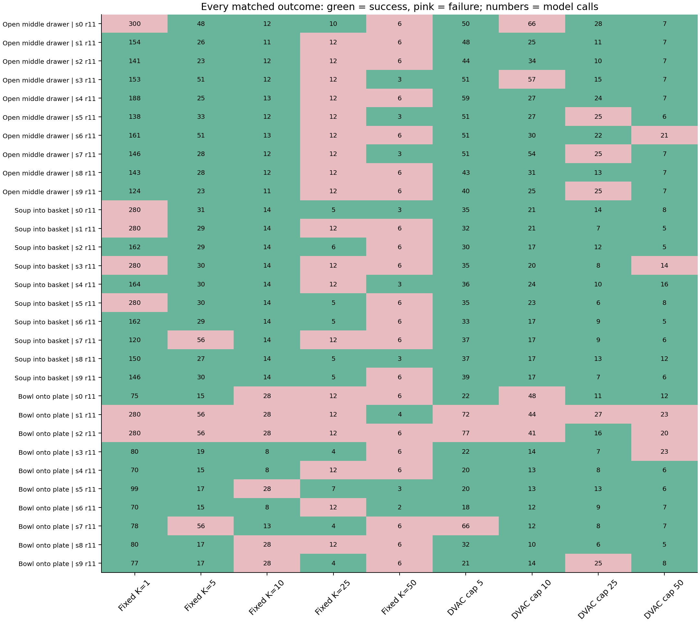

# SmolVLA: fixed and capped adaptive replanning

This matched comparison contains **270 episodes**: 150 retained fixed-interval controls and 120 capped-DVAC episodes, covering the same 30 task/initial-state settings with policy seed 11. There are five fixed intervals (1, 5, 10, 25, 50) and four adaptive caps (5, 10, 25, 50). The checkpoint generates 50 actions with ten flow-matching steps for every method.

## Matched completion and model calls

| Method | Completed | Completion, descriptive 95% interval | Calls/episode, descriptive 95% interval | Calls/100 actions |
|---|---:|---:|---:|---:|
| Fixed K=1 | 23/30 | 76.7% [63.3, 90.0] | 162.0 [140.1, 186.5] | 100.00 |
| Fixed K=5 | 26/30 | 86.7% [73.3, 96.7] | 31.3 [26.9, 36.3] | 20.23 |
| Fixed K=10 | 24/30 | 80.0% [70.0, 90.0] | 15.5 [13.5, 17.4] | 10.22 |
| Fixed K=25 | 11/30 | 36.7% [20.0, 53.3] | 9.6 [8.6, 10.6] | 4.18 |
| Fixed K=50 | 9/30 | 30.0% [13.3, 46.7] | 5.1 [4.6, 5.6] | 2.13 |
| DVAC cap 5 | 27/30 | 90.0% [80.0, 100.0] | 40.2 [35.6, 45.5] | 29.24 |
| DVAC cap 10 | 25/30 | 83.3% [70.0, 93.3] | 26.4 [22.2, 30.7] | 17.53 |
| DVAC cap 25 | 25/30 | 83.3% [70.0, 93.3] | 14.1 [12.1, 16.2] | 8.97 |
| DVAC cap 50 | 25/30 | 83.3% [70.0, 93.3] | 9.5 [7.7, 11.5] | 6.86 |

Calls per episode include early stopping on success. Calls per 100 actions use the ratio of total calls to total executed actions, so the two measures answer different questions. The observed Pareto set in `observed_frontier.csv` describes sample means; it does not establish a statistically superior method.

## Designated comparisons

**DVAC cap 10 versus Fixed K=10:** completion differed by +3.3 percentage points (descriptive paired 95% interval -10.0 to +16.7); model calls differed by +10.9 per episode. There were 3 settings where only DVAC cap 10 succeeded, and 2 with the reverse outcome.

**DVAC cap 10 versus DVAC cap 50:** completion differed by +0.0 percentage points (descriptive paired 95% interval -16.7 to +16.7); model calls differed by +16.9 per episode. There were 3 settings where only DVAC cap 10 succeeded, and 3 with the reverse outcome.

DVAC cap 10 versus fixed K=10 tests the value of sometimes updating earlier under the same maximum execution interval. A cap-10 policy cannot reduce calls per executed action below the fixed-10 schedule: its prefixes are at most ten actions. Cap 10 versus cap 50 tests whether restricting long open-loop prefixes changes completion and cost. Fixed K=1 and K=5 help locate the overall trade-off.

## Task results and every matched outcome

The complete numerical task table is in `by_task.csv`. `outcome_matrix.csv` contains every task, initial state, seed, method outcome and call count; no episodes are selected according to success.

## What the execution cap changes

DVAC calculates one variance for each of the 50 future actions from its last five internal clean-action estimates. The threshold uses all 50 variance values from each of up to five preceding calls. The chosen uncapped prefix is then limited by `K = min(execution_cap, raw_DVAC_K)`. The horizon, variance calculation, alpha=2, history length, and mandatory first-call K=1 are unchanged. The cap does not shorten the model prediction or remove future actions from the threshold statistics.

| Cap | Mean raw DVAC K | Mean selected K | Mean executed prefix | Calls limited by cap | K=1 after initialization |
|---:|---:|---:|---:|---:|---:|
| 5 | 20.02 | 3.45 | 3.42 | 57.9% | 34.2% |
| 10 | 18.65 | 5.87 | 5.70 | 47.0% | 38.4% |
| 25 | 18.97 | 11.92 | 11.15 | 34.3% | 38.4% |
| 50 | 16.09 | 16.09 | 14.58 | 0.0% | 42.7% |

Mean K values above weight policy calls equally. Executed prefixes may be shorter than selected prefixes because an episode terminates. Raw K statistics across caps come from different trajectories and observations; they are not a replay of an identical variance sequence.

## Reuse checks and timing

The retained fixed controls match the adaptive experiment's checkpoint and backbone revisions, base policy source hash, dependency lock, package versions, simulator asset revision, tasks and limits, precision, observation processing, 20 Hz control, settling and sampling-seed rule. The independent verification checks identical initial-state and observation hashes and identical complete first action predictions across the matched controls and adaptive runs. Raw logs and their saved checksums remain intact.

Historical controls used six Torch CPU threads; adaptive collection uses one and records internal flow-matching diagnostics. Their wall times and inference times therefore do not provide a controlled fixed-versus-adaptive speed comparison. The common cost measure is model calls. `adaptive_timing.csv` reports timing only among the four adaptive caps, which share instrumentation and run conditions. The synchronous simulator pauses during inference.

## Statistical interpretation

Intervals use 10,000 paired bootstrap draws. Each draw resamples initial states with replacement separately within each task, keeping every method and all seed repetitions together. Task means receive equal weight. Ratios are recomputed in each draw. These are descriptive intervals for the observed design, not multiplicity-adjusted confirmatory tests. The state outcomes were already examined when developing the comparison, so this is not a held-out evaluation. No p-value or claim of equivalence is made. A degenerate bootstrap interval can occur when all observed states have the same outcome; it does not guarantee that unseen states will behave identically.

Only one policy seed is included in this matched cohort. The results quantify variation across initial situations but do not establish robustness to generation noise. The three selected tasks are fixed, so the intervals do not estimate uncertainty over arbitrary new task families. Internal denoising variance is not a calibrated failure probability; stable internal predictions can still lead to inaccurate grasps. Gripper close-command counts are action diagnostics, not verified grasp-error labels. Changing K combines new observations with stochastic action regeneration.

All generated tables and figures are bound to `analysis.json` by `artifacts.json`. `verification.json` records full coverage, action/decision replay, source hashes and matching checks.
