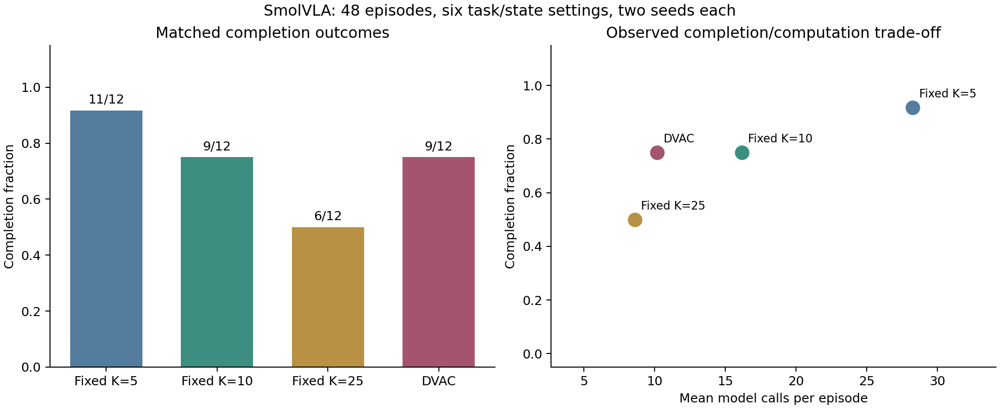
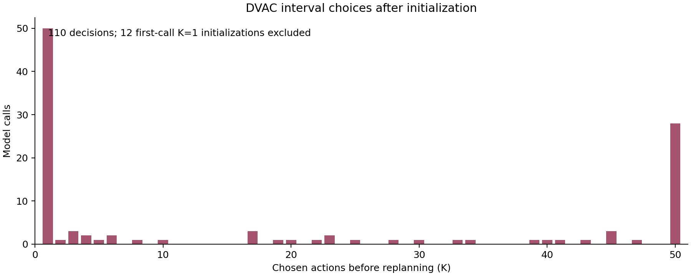
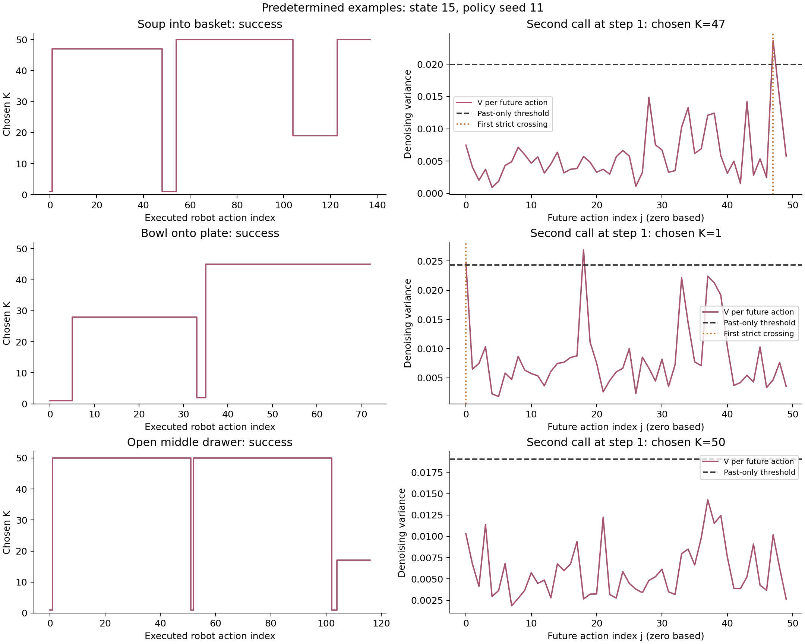

# SmolVLA: adaptive replanning with DVAC

This comparison contains **48 verified episodes**, with 12 per method. Each method uses the same frozen checkpoint, three tasks, two initial states per task, and two policy seeds. Every fixed-interval control uses the same flow-matching diagnostic instrumentation as DVAC.

## Completion and computation

| Method | Completed | Completion | Descriptive Wilson 95% interval | Calls/episode | Calls/action | Inference s/episode | Selector ms/episode | Wall s/episode |
|---|---:|---:|---:|---:|---:|---:|---:|---:|
| Fixed K=5 | 11/12 | 91.7% | 64.6–98.5% | 28.2 | 0.203 | 22.41 | 0.000 | 30.68 |
| Fixed K=10 | 9/12 | 75.0% | 46.8–91.1% | 16.2 | 0.102 | 12.85 | 0.000 | 21.74 |
| Fixed K=25 | 6/12 | 50.0% | 25.4–74.6% | 8.6 | 0.042 | 6.87 | 0.000 | 17.64 |
| DVAC | 9/12 | 75.0% | 46.8–91.1% | 10.2 | 0.062 | 8.16 | 0.497 | 16.91 |

Calls/action is the pooled number of calls divided by executed actions. Episode lengths can differ because successful episodes stop early; both per-episode and per-action measures are therefore reported. The Wilson intervals are descriptive binomial intervals. They do not account for dependence between seeds sharing an initial state and must not be interpreted as a significance test.

## Results by task

| Task | Method | Completed | Calls/episode | Compute s/episode |
|---|---|---:|---:|---:|
| Soup into basket | Fixed K=5 | 4/4 | 29.5 | 27.24 |
| Soup into basket | Fixed K=10 | 4/4 | 14.5 | 15.31 |
| Soup into basket | Fixed K=25 | 4/4 | 5.8 | 8.07 |
| Soup into basket | DVAC | 3/4 | 11.5 | 13.69 |
| Bowl onto plate | Fixed K=5 | 4/4 | 15.8 | 14.93 |
| Bowl onto plate | Fixed K=10 | 3/4 | 13.0 | 14.44 |
| Bowl onto plate | Fixed K=25 | 2/4 | 8.0 | 12.36 |
| Bowl onto plate | DVAC | 4/4 | 5.8 | 8.27 |
| Open middle drawer | Fixed K=5 | 3/4 | 39.5 | 36.41 |
| Open middle drawer | Fixed K=10 | 2/4 | 21.0 | 22.11 |
| Open middle drawer | Fixed K=25 | 0/4 | 12.0 | 17.76 |
| Open middle drawer | DVAC | 2/4 | 13.2 | 16.14 |

## Matched outcome differences

A pair has the same task, initial state, and policy seed. Differences below are DVAC minus the fixed method.

| Reference | DVAC succeeds, fixed fails | Fixed succeeds, DVAC fails | Both succeed | Both fail | Completion difference | Mean call difference |
|---|---:|---:|---:|---:|---:|---:|
| Fixed K=5 | 0 | 2 | 9 | 1 | -16.7 percentage points | -18.1 |
| Fixed K=10 | 1 | 1 | 8 | 2 | +0.0 percentage points | -6.0 |
| Fixed K=25 | 4 | 1 | 5 | 2 | +25.0 percentage points | +1.6 |

There are six physical task/state settings, each repeated with two sampling seeds. The complete paired outcomes and the means over seeds within each physical setting are retained in `paired_outcomes.csv` and `physical_setting_differences.csv`. No p-value is reported.

## Every matched run

Each method cell shows outcome and model calls. These are all planned task/state/seed pairs.

| Task | State | Seed | Fixed K=5 | Fixed K=10 | Fixed K=25 | DVAC |
|---|---:|---:|---:|---:|---:|---:|
| Open middle drawer | 15 | 11 | Success / 25 calls | Success / 12 calls | Failure / 12 calls | Success / 7 calls |
| Open middle drawer | 15 | 22 | Failure / 60 calls | Failure / 30 calls | Failure / 12 calls | Failure / 16 calls |
| Open middle drawer | 16 | 11 | Success / 28 calls | Success / 12 calls | Failure / 12 calls | Success / 7 calls |
| Open middle drawer | 16 | 22 | Success / 45 calls | Failure / 30 calls | Failure / 12 calls | Failure / 23 calls |
| Soup into basket | 15 | 11 | Success / 28 calls | Success / 14 calls | Success / 5 calls | Success / 11 calls |
| Soup into basket | 15 | 22 | Success / 31 calls | Success / 16 calls | Success / 6 calls | Success / 7 calls |
| Soup into basket | 16 | 11 | Success / 30 calls | Success / 13 calls | Success / 5 calls | Success / 5 calls |
| Soup into basket | 16 | 22 | Success / 29 calls | Success / 15 calls | Success / 7 calls | Failure / 23 calls |
| Bowl onto plate | 15 | 11 | Success / 15 calls | Success / 8 calls | Failure / 12 calls | Success / 8 calls |
| Bowl onto plate | 15 | 22 | Success / 15 calls | Success / 8 calls | Success / 4 calls | Success / 3 calls |
| Bowl onto plate | 16 | 11 | Success / 17 calls | Failure / 28 calls | Failure / 12 calls | Success / 8 calls |
| Bowl onto plate | 16 | 22 | Success / 16 calls | Success / 8 calls | Success / 4 calls | Success / 4 calls |

## Adaptive interval behavior

DVAC chose a mean K of **17.78** across all calls (median 1, range 1–50). The actual mean executed prefix was 16.17 actions, which can be shorter because an episode ends inside a selected prefix. The 12 mandatory first-call K=1 decisions are distinguished from later choices.

Among 110 later calls, 50 chose K=1 and 28 chose K=50; 28 had no variance crossing. These counts describe how the rule behaved and are not calibrated failure probabilities.

The examples below use the predetermined first initial state and first policy seed for all three tasks. The variance panel always shows the second policy call, so its selection is independent of the outcome.

## Timing and evidence

Inference time includes the instrumented policy prediction and variance calculation. Selector time is measured separately. Compute time is inference plus selection plus simulator stepping. Episode wall time includes reset, rollout, and video writer closure, but excludes JSON serialization, hashing, and publication of the evidence directory. The simulator pauses during inference. The plain-versus-instrumented equality check is an integrity check; its ordered first calls are not a valid estimate of instrumentation overhead.

The independent verifier checked all 758 generated chunks and 7995 executed actions, including variance replay, past-only rolling thresholds, selected prefixes, seed mapping, initial-state matching, final action execution, and evidence checksums. The first complete predictions match exactly across all methods within each state/seed pair. `verification.json` records the checks and evidence hashes.

## Interpretation and limits

These observations test transfer of the DVAC decision rule to SmolVLA. They do not reproduce the paper's complete setup or establish an official LIBERO score. The first-call K=1 initialization and use of seven valid action channels are explicit implementation choices. The model, normalization, ten-step solver, five-estimate tail, five-call history, and alpha=2 are fixed before comparison.

Success differences must be considered together with model calls and runtime. More frequent updates may help some trajectories and cannot guarantee correction of an inaccurate grasp or an incorrect plan. Internal denoising stability is not action correctness. The comparison combines the effects of fresh observations and new stochastic generation; it does not isolate those mechanisms. Only six task/state settings are represented, so broad generalization is unsupported. Gripper close-command counts are control diagnostics, not verified grasp or failure annotations.

See `docs/dvac-protocol.md` for the mathematical rule, complete design, and predetermined demo selection.
