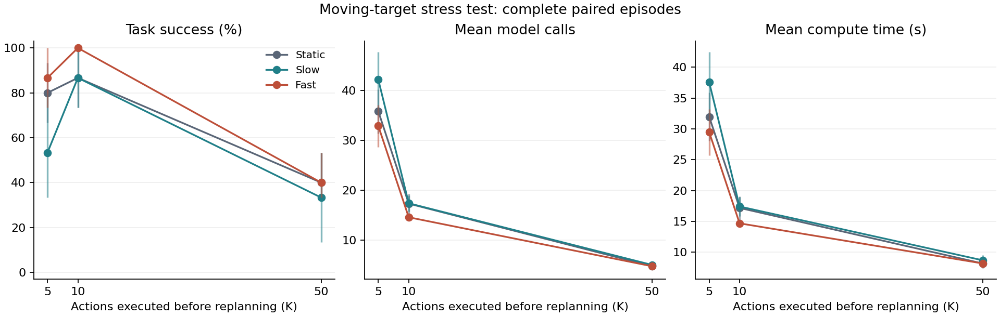
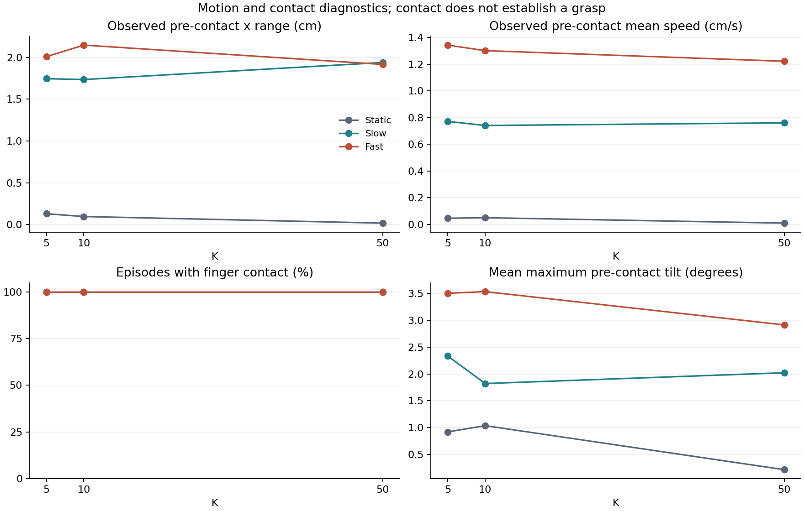

# Moving-target replanning experiment

This is an altered-environment stress test of SmolVLA on the LIBERO alphabet-soup task. Its results are reported separately from standard LIBERO performance.

## Question and method

Does changing the interval between observations and action-chunk regeneration change robustness when the target can moves during the robot's approach?

The complete design contains **135 episodes**: 5 initial states × 3 policy seeds × 3 execution intervals × three conditions. Initial state IDs: (10, 11, 12, 13, 14); policy seeds: (11, 22, 33); K: (5, 10, 50).

The policy predicts 50 actions per call. The robot executes the first K at 20 Hz and then receives a fresh observation. Simulation pauses during model inference. Motion follows simulation time, not wall-clock time. The force intervention never triggers an extra policy call.

The commanded path oscillates along world x about the initial can position with amplitude 2.0 cm. The slow and fast periods are 8 s and 4 s. It starts after 0.5 s with a 1 s ramp. A bounded physical force (maximum 1 N) tracks this path; its application point is 3 cm below the object center of mass. The corresponding y-axis moment is offset_z × force_x, equivalent to applying that force at the offset point; there is no separate orientation servo. The object is not teleported. The static control applies no motion force or moment. Motion force stops permanently at first finger contact in moving conditions. The object can subsequently move through normal physics and robot contact.

The actual trajectory depends on friction and contact. Slow/fast label the commanded trajectory, so measured pre-contact motion and tracking error are reported below. Physical initial-state and initial-observation hashes match across treatments and policy seeds.

## Completion and cost

| Condition | K | Success | Mean calls | Mean compute (s) | Mean episode wall time (s) |
|---|---:|---:|---:|---:|---:|
| static | 5 | 12/15 (80.0%) | 35.8 | 31.98 | 36.70 |
| static | 10 | 13/15 (86.7%) | 17.3 | 17.18 | 21.79 |
| static | 50 | 6/15 (40.0%) | 4.8 | 8.17 | 13.59 |
| slow | 5 | 8/15 (53.3%) | 42.1 | 37.57 | 42.74 |
| slow | 10 | 13/15 (86.7%) | 17.4 | 17.42 | 22.04 |
| slow | 50 | 5/15 (33.3%) | 5.1 | 8.69 | 14.19 |
| fast | 5 | 13/15 (86.7%) | 32.9 | 29.48 | 34.00 |
| fast | 10 | 15/15 (100.0%) | 14.6 | 14.69 | 18.93 |
| fast | 50 | 6/15 (40.0%) | 4.8 | 8.18 | 13.55 |

Compute time is inference plus simulator stepping; episode wall time also includes reset, in-memory telemetry and video creation, recording and finalization. It excludes JSON log writing, file checksums, model loading and warmup. Lower cost can reflect an early success or failure as well as a larger K.

## Paired change from the static control

Differences are moving-condition success minus static success at the same K. Negative values indicate reduced completion under target motion.

| Condition | K | Difference (percentage points) | Exploratory 95% interval |
|---|---:|---:|---:|
| slow | 5 | -26.7 | [-46.7, -6.7] |
| slow | 10 | +0.0 | [-20.0, 20.0] |
| slow | 50 | -6.7 | [-20.0, 0.0] |
| fast | 5 | +6.7 | [0.0, 20.0] |
| fast | 10 | +13.3 | [0.0, 26.7] |
| fast | 50 | +0.0 | [0.0, 0.0] |

Percentile bootstrap with 5000 draws resamples initial states, keeping all seeds, K values and conditions together within each sampled state. Seeds are repeated policy samples, not additional independent scene clusters. Only 5 initial-state clusters are available; uncertainty estimates are weak and identical outcomes can produce zero-width intervals. The bootstrap is conditional on the selected seed set and task. The intervals are exploratory and are not adjusted for multiple comparisons. A difference whose interval includes zero does not establish equivalence.

## Exploratory interaction between motion and K

The interaction is (moving − static at K) − (moving − static at K=10). A positive estimate means that the motion-related change in success is more favorable at that K than at K=10. The same paired initial-state bootstrap is used, retaining all seeds. This accounts for baseline success differences but cannot remove floor/ceiling constraints or contact-dependent exposure. Raw success counts for all cells are given above.

| Condition | K vs. 10 | Interaction (percentage points) | Exploratory 95% interval | State clusters / seeds |
|---|---:|---:|---:|---:|
| slow | 5 | -26.7 | [-46.7, -6.7] | 5 / 3 |
| slow | 50 | -6.7 | [-26.7, 13.3] | 5 / 3 |
| fast | 5 | -6.7 | [-26.7, 13.3] | 5 / 3 |
| fast | 50 | -13.3 | [-26.7, 0.0] | 5 / 3 |

## Observed motion and contact

| Condition | K | Contact / episodes | No contact | Contact time among contacts (s) | Mean pre-contact x range (cm) | Mean pre-contact speed (cm/s) |
|---|---:|---:|---:|---:|---:|---:|
| static | 5 | 15/15 | 0 | 2.57 | 0.13 | 0.05 |
| static | 10 | 15/15 | 0 | 2.62 | 0.10 | 0.05 |
| static | 50 | 15/15 | 0 | 2.46 | 0.02 | 0.01 |
| slow | 5 | 15/15 | 0 | 2.56 | 1.74 | 0.77 |
| slow | 10 | 15/15 | 0 | 2.55 | 1.73 | 0.74 |
| slow | 50 | 15/15 | 0 | 2.83 | 1.94 | 0.76 |
| fast | 5 | 15/15 | 0 | 2.61 | 2.01 | 1.34 |
| fast | 10 | 15/15 | 0 | 2.57 | 2.15 | 1.30 |
| fast | 50 | 15/15 | 0 | 2.42 | 1.91 | 1.22 |

Largest observed pre-contact tilt across K: static: 3.1°; slow: 5.6°; fast: 7.4°. The tilt diagnostic checks whether an intended sliding target also tips or rotates substantially.

Contact time is conditional on an observed finger-contact event. Episodes without contact are counted explicitly and are excluded from that time average; they are not assigned zero time. Contact is neither a verified grasp nor successful recovery. Pre-contact motion includes the initial delay, ends before first recorded contact, and therefore has a different observation duration in different episodes. Ranges, force exposure, tracking error and saturation are recorded at physics-substep resolution; mean speed is a control-rate finite-difference diagnostic. Tracking error and force-saturation diagnostics are available in contact-coverage.csv.

## Interpretation limits

- This single-task modification evaluates robustness to a specified artificial force, not real-world moving-object grasping or the unmodified LIBERO benchmark.
- Force exposure stops at contact. Successful approaches can receive a shorter intervention; total displacement is an outcome-dependent diagnostic, not an independently randomized dose.
- Reference phase is fixed. The first scheduled replan strictly after the configured onset is K=5: 0.75 s; K=10: 1.00 s; K=50: 2.50 s, if the episode continues. An oscillating target can return toward an older planned grasp position, so a shorter reference period need not be harder. Actual motion can lag the reference. This is a possible timing mechanism, not a verified explanation of any individual outcome.
- Smaller K changes both the arrival of fresh observations and stochastic regeneration of the action sequence. These mechanisms are not isolated by this experiment.
- The simulator pauses during inference. The study does not measure a robot tracking an object that continues moving during real-world inference latency.
- There are few independent initial states and only one checkpoint. Numeric rankings alone do not establish a general optimal K or a reliable difference between close results.
- Native simulator success is used as recorded; post-release stability and missed-grasp event counts require separate evidence and are not inferred from finger contact.

## Reproducibility

Model: `HuggingFaceVLA/smolvla_libero` at `6721902bc4d61e50a3bfdb11dfb4cb626f05d102`. Configuration fingerprint: `ac5a6c8af0fb65b513a00de6099a050a368a4dee7a252a8adaafad0c29bcc859`.

statistics.json contains the complete configuration, runtime metadata, bootstrap settings and SHA-256 evidence for every raw episode file. artifacts.json binds this report and its plots to that statistics record and to the analysis source. No raw episode is modified during analysis. All planned episodes must be present before this report is generated.
